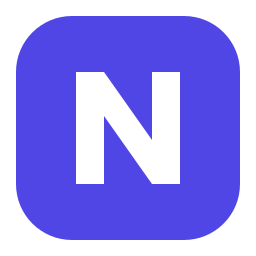
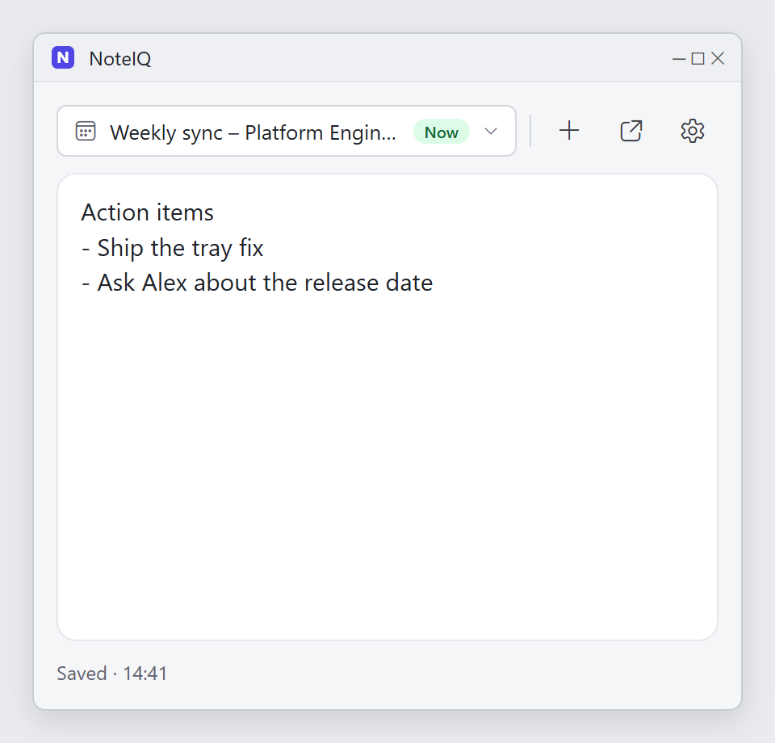
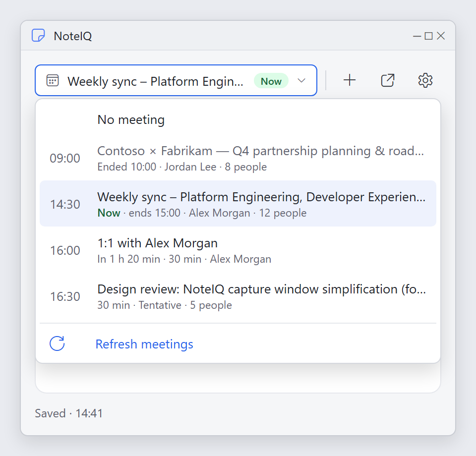
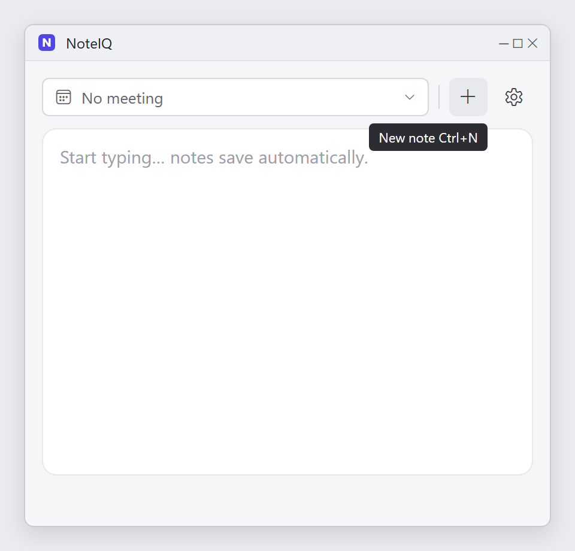
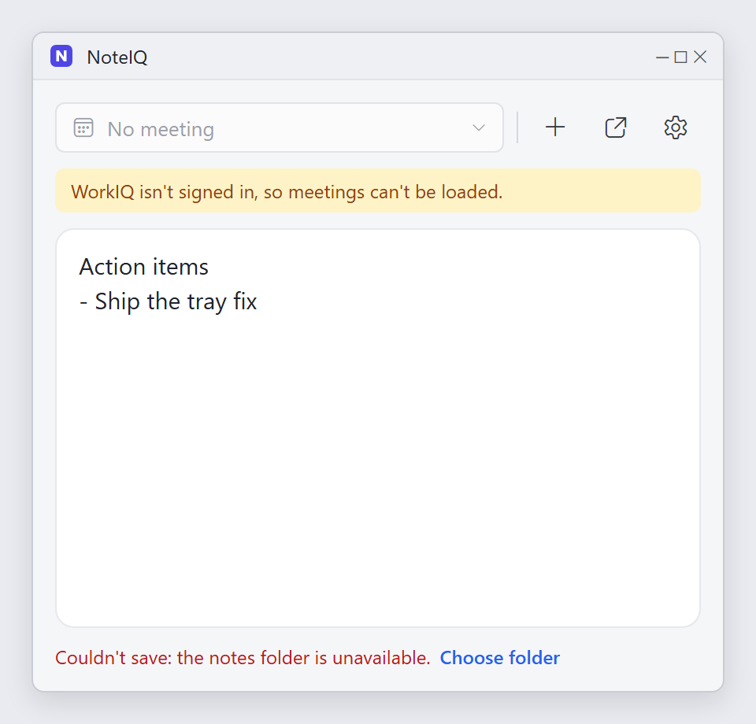
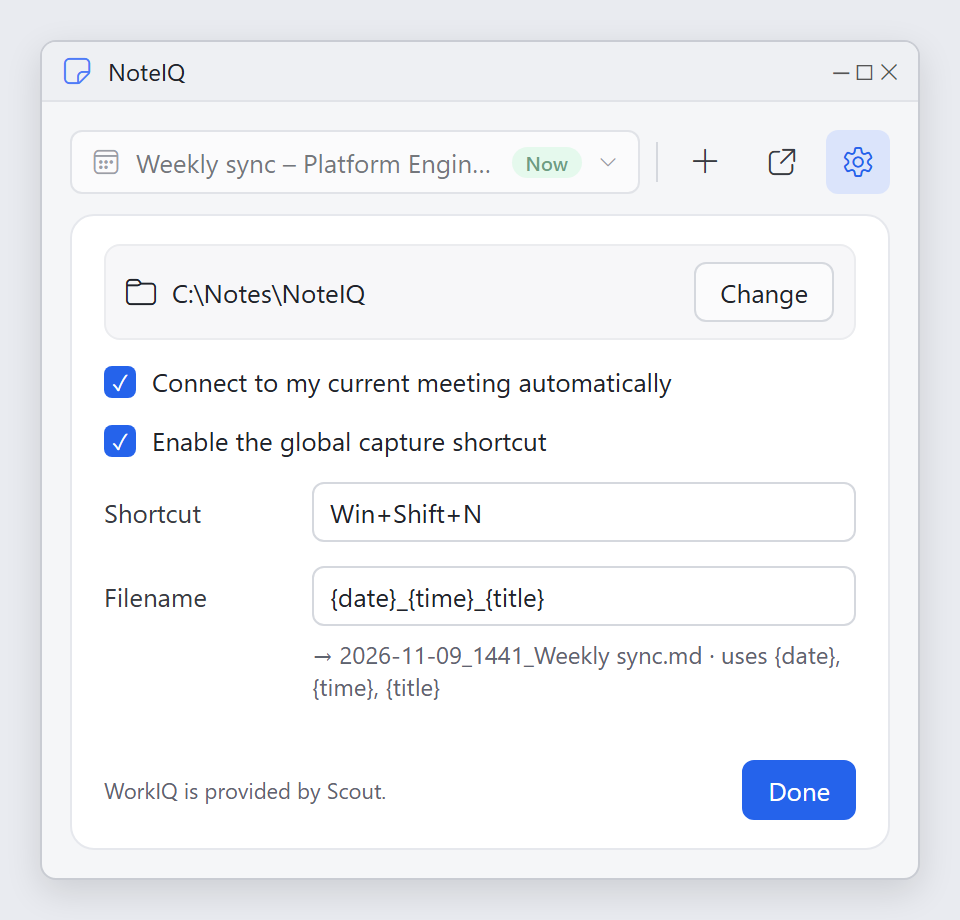
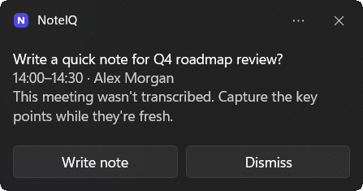

<p align="center">
  
</p>

<h1 align="center">NoteIQ</h1>

<p align="center"><strong>Quick-capture Markdown notes for Windows, with meeting context built in.</strong></p>

NoteIQ is a Windows x64 and ARM64 quick-capture app for Markdown notes. It opens a
small editor, timestamps each capture, optionally adds current-meeting context
from Scout's existing WorkIQ executable, and writes to one selected notes
folder.

The default destination is the current user's
`OneDrive - Microsoft\projects\personal-assistants\notes` vault. Notes are
created under `captures\YYYY\MM\`. NoteIQ does not install WorkIQ, duplicate
notes into another location, or require an Obsidian process.

Filenames follow the **Note filename** setting, `{date}_{time}_{title}` by
default, such as `2026-11-03_1415_project-review.md`. The title is the meeting
name, or the note's first line when no meeting is attached. While a note is
open, its file follows meeting changes without losing its timestamp or
overwriting other notes. Closed notes are never renamed, and a changed setting
applies only to new notes.

<p align="center">
  
</p>

<p align="center">
  <a href="docs/images/meeting-picker.png"></a>
  <a href="docs/images/new-note.png"></a>
  <a href="docs/images/problems.png"></a>
  <a href="docs/images/settings.png"></a>
</p>

<p align="center"><sub>Mockups. Select an image to enlarge it. Meetings and people are fictional.</sub></p>

## Build and test

Run the portable core tests on Linux x64 or ARM64 (including WSL):

```sh
cargo test -p noteiq-core
cargo fmt --all -- --check
dprint check --allow-no-files
```

### Commit hooks

Install the tools pinned in `.mise.toml` (for example, `mise install`), and make
`cargo`, `dprint`, `gitleaks`, and `lefthook` available on your PATH. Run
`lefthook install` after cloning: the tracked `.lefthook.toml` alone does not
activate Git hooks. The pre-commit hook checks Rust and Markdown formatting and
scans staged changes for secrets with gitleaks, and blocks the commit if a check
fails or a required tool is missing. Use `cargo fmt --all` and `dprint fmt` to
fix formatting before retrying.

For an isolated linked worktree, keep its hooks separate from other checkouts:

```sh
git config extensions.worktreeConfig true
git config --worktree core.hooksPath .git-hooks
lefthook install
```

Repeat installation in each worktree that needs hooks. `.git-hooks` contains
generated local hooks and is not committed.

Run the Windows UI acceptance tests natively on Windows:

```powershell
cargo test -p noteiq-windows --features desktop
```

Build on Windows x64 with the x64 Rust target, Visual Studio C++ tools, and
Windows SDK:

```powershell
cargo build --release --features desktop -p noteiq-windows --target x86_64-pc-windows-msvc
```

For a native ARM64 build, use a Windows ARM64 developer environment with the
ARM64 Rust target, Visual Studio C++ tools, and Windows SDK:

```powershell
cargo build --release --features desktop -p noteiq-windows --target aarch64-pc-windows-msvc
```

The resulting `noteiq.exe` is under the corresponding
`target\<target-triple>\release\` directory.

## CI and releases

The CI/CD workflows are implemented for Linux x64/ARM64 core checks and
Windows x64/ARM64 desktop checks and release packages. Shared repository
automation reuses pinned `DevSecNinja/.github` workflows; Rust checks, Windows
builds, and draft-release publishing remain repository-local. Local x64
(emulated), ARM64, and WSL validation passed, including PE architecture
verification. GitHub-hosted CI has not run: these changes are uncommitted and
no remote writes were authorized. Release archives include the executable,
README, LICENSE, a CycloneDX SBOM per architecture, a SHA-256 checksum file per
asset, and GitHub build and SBOM attestations. The release notes link directly to
both ZIPs. See
[setup and release verification](docs/setup.md#ci-cd-and-release-verification)
for release verification, the tag-bound manual retry command, and required
repository setup. Downloads are not Authenticode-signed; checksums and
attestations do not remove the Windows SmartScreen warning.

## Launch

Start `noteiq.exe` to open a capture. While NoteIQ is running, use
**Win+Shift+N** to show the capture window. If another app already owns that
shortcut, choose one such as `Ctrl+Alt+N` in **Settings** and press **Enter**
or **Done** to apply it. Notes save automatically, and `Ctrl+S` saves at once.
The icon buttons next to the meeting list start a **New note** (also `Ctrl+N`),
**Open note** in the registered Markdown application once it is saved, and open
**Settings**. Closing the window with its title-bar **×** saves the
note, deletes it if it is empty, and keeps NoteIQ in the tray; use the tray
menu to show the window, start a new note, or quit.

The app registers the per-user `noteiq://new` protocol on first launch. This
can be entered or invoked by a PowerToys Command Palette command. The CLI
command `noteiq new` brings an open capture to the front, or starts a fresh
capture when none is open.

After a Teams meeting you joined on this PC ends without a transcript, NoteIQ
shows a Windows notification suggesting a quick note; **Write note** opens a
note connected to that meeting. Turn this off with **Suggest a note after
untranscribed meetings** in **Settings**. See
[docs/setup.md](docs/setup.md#note-reminders-after-meetings).

<p align="center">
  
</p>

Turn on **Meeting templates** in **Settings** to start each meeting note from a
template, such as **General meeting**, **1:1**, **Customer call**, or
**Stand-up**, or one you create. Templates fill in placeholders such as
`{title}` and `{attendees}` and never replace text you have typed. See
[docs/setup.md](docs/setup.md#meeting-templates).

The **Meeting** list starts with **No meeting**, followed by current, earlier,
and upcoming meetings on two lines: the time and title, then details such as
**Now**, **Transcribed**, how long the meeting runs, the organizer, and how many people are invited. A note attaches automatically
when exactly one meeting is in progress, including one that starts while an
empty note is open; a meeting you choose, or **No meeting**, is never replaced.
The tray process retains the list between notes, and **Refresh meetings** at the
bottom of the list asks WorkIQ again. Saved meeting metadata groups required and optional invitees using
`Name <email>` values; the note body lists their RSVP and reported attendance.
See [Choosing a meeting](docs/setup.md#choosing-a-meeting) and
[Note layout](docs/setup.md#note-layout).

For folder selection, settings, Scout/WorkIQ troubleshooting, and logs, see
[docs/setup.md](docs/setup.md).
